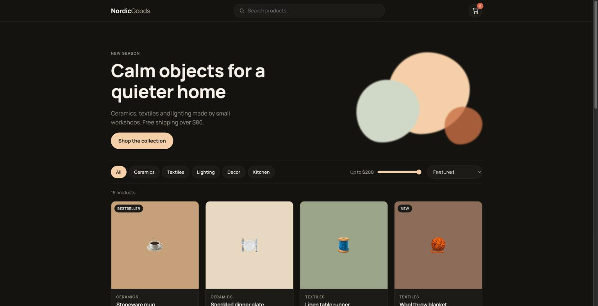

# Storefront UI

A complete e-commerce front end in plain HTML, CSS and JavaScript. No framework, no build step, no backend:
drop it on any static hosting and swap the product data for your API.



**Live demo:** https://tigran-ohanyan.github.io/storefront-ui/

## Features

- Catalog of 16 products with category chips, price slider, text search and five sort orders
- Quick view modal with quantity picker
- Cart drawer: quantity controls, remove, subtotal, promo codes (`WELCOME10`, `SPRING15`), free shipping threshold
- Cart persisted in `localStorage`, survives reloads
- Checkout form with validation and an order confirmation screen (nothing is sent anywhere)
- Light and dark themes following the system setting
- Keyboard accessible: skip link, `Esc` closes dialogs, focusable controls with labels
- Responsive from 320px to desktop

## Structure

```
index.html        markup for the page, modals and the cart drawer
css/style.css     design tokens, layout, components, dark theme, breakpoints
js/products.js    catalog data (replace with a fetch to your API)
js/app.js         state, rendering, cart, checkout, events
```

## Run locally

```bash
python -m http.server 8000
# open http://localhost:8000
```

## Plugging in a backend

- Load products: replace `window.PRODUCTS` in `js/products.js` with the result of `fetch('/api/products')`
- Checkout: in `handleCheckout()` post the form data and `cartTotals()` to your order endpoint before showing the confirmation
- Promo codes: move the `PROMOS` map to the server and validate there

## License

MIT
